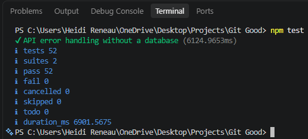
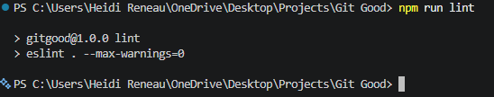
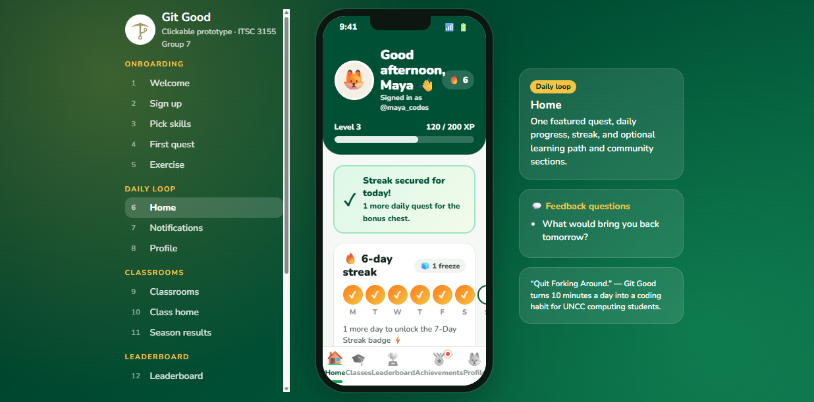

# Sprint 2 test results

Part 7 evidence for issue #18. Run on Heidi's computer against a local PostgreSQL test database (`gitgood_test`), after PRs #45 (sign-up saved to the database) and #46 (sign-in with hashed passwords) were merged.

**Date run:** 11/13/2026 · **Commit tested:** `cb5d2a9` (from `git log -1 --oneline`)

## Automated tests: `npm test`

| Result | Count |
|---|---|
| Tests | 52 |
| Passed | 52 |
| Failed | 0 |

What the tests cover (rubric item 9):

| Requirement | Test file | Tests |
|---|---|---|
| Successful data operation | `tests/students-api.test.js` | Creating a student and reading it back on a new connection; saving built-in and custom skills; signing in with the right password; the full sign-up → skills → profile API flow |
| Invalid input / error handling | `tests/student-validation.test.js`, `tests/students-api.test.js` | Non-UNCC email, bad username, too-short password, invalid skill lists, duplicate email or username (409), wrong password (401), unknown student (404), malformed JSON (400), database down (503) |
| The database user story (#44) | `tests/students-api.test.js` | Every acceptance criterion of #44 that can be automated |

The database tests use the separate `gitgood_test` database and delete only the rows they create, so nobody's `gitgood` data is touched.

## Lint: `npm run lint`

ESLint reported 0 errors and 0 warnings.

## Persistence check (Part 5)

1. `npm start`, created a new account with a `@charlotte.edu` email and password, and picked skills.
2. Stopped the server (Ctrl+C) and ran `npm start` again.
3. Signed in on the welcome page with the same email and password, then opened Profile: the same username and skills loaded, with "Saved in the database · member since …".
