# Sprint 1 testing evidence

This page shows how each Sprint 1 user story was checked against its acceptance criteria. Every screenshot comes from the real app running locally (`python3 -m http.server`) at phone size. You can repeat any check on the [live prototype](https://hrwool.github.io/GitGood/).

**Quick links:** [#1 Skills practiced](#1-skills-practiced-after-a-quest) · [#3 Quests match your skills](#3-quests-match-your-selected-skills) · [#4 Baseline app](#4-baseline-app-sign-up-with-a-uncc-email) · [#2 Decluttered home](#2-decluttered-home-dashboard) · [#6 Friend invites](#6-friend-invites) · [#7 Lint and automated tests](#7-lint-and-automated-tests)

| Issue | User story | Pull request | Result |
|---|---|---|---|
| [#1](https://github.com/HRWool/GitGood/issues/1) | View the skills I practiced after a quest | [#9](https://github.com/HRWool/GitGood/pull/9) | ✅ All criteria met |
| [#3](https://github.com/HRWool/GitGood/issues/3) | Practice problems match the skills I selected | [#10](https://github.com/HRWool/GitGood/pull/10) | ✅ All criteria met |
| [#7](https://github.com/HRWool/GitGood/issues/7) | Lint tool checks our code | [#8](https://github.com/HRWool/GitGood/pull/8) | ✅ 0 problems |
| [#4](https://github.com/HRWool/GitGood/issues/4) | Sign up with a UNCC email and complete a quest | built in the prototype | ✅ Checked below |
| [#2](https://github.com/HRWool/GitGood/issues/2) | Understand the UI (less clutter) | commit 37fe499 | ✅ Shown below |
| [#6](https://github.com/HRWool/GitGood/issues/6) | Invite friends to the leaderboard | commit 2590736 | ⚠️ Partly shown, see note |

---

## #1 Skills practiced after a quest

> As a student, I want to view the skills I practiced in an assignment after completing it so that I can understand what I learned and track my progress.

| Acceptance criterion | How we checked | Result |
|---|---|---|
| Completion screen displays all skills covered | Passed the "Count the café orders" quest (`orders`, `+=`). The reward screen lists **Python · for loops · lists · running totals**. Repeated with the SQL quest. | ✅ |
| Users can review the summary before leaving | The summary stays on screen until **Continue** is pressed | ✅ |
| Summary is consistent with assignment content | The chips come from the same quest data that builds the exercise. `tests/skills-practiced.test.js` checks every quest has a known skill and a list of concepts. | ✅ |

<p>
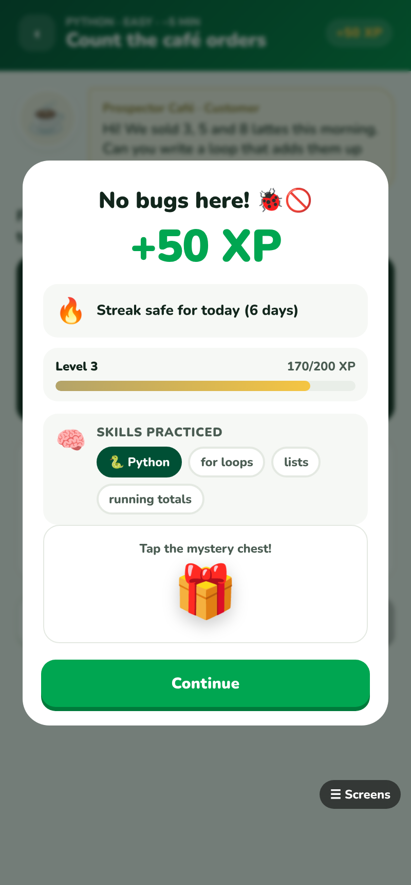
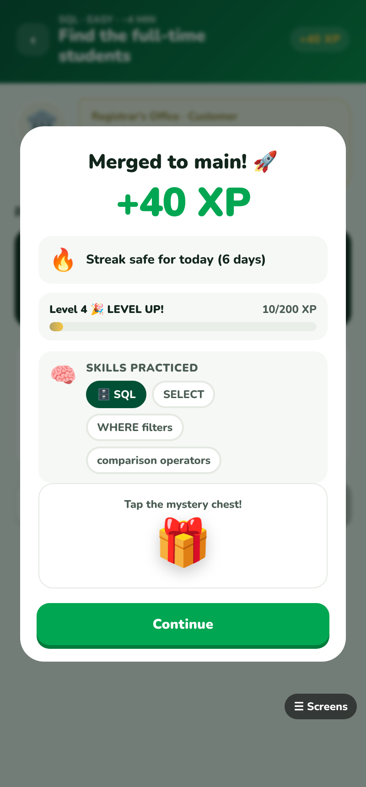
</p>

## #3 Quests match your selected skills

> As a student, I want practice problems to match the skills I selected so that I can focus on learning content relevant to my goals.

| Acceptance criterion | How we checked | Result |
|---|---|---|
| Only daily questions from selected skills | Signed up and picked only **Java**, then finished the intro quest. Home offers only the Java quest. | ✅ |
| Respects current career path settings | Added **SQL** on the Profile page. Home now offers Java and SQL. | ✅ |
| Handles multiple selected skills | With SQL, DSA, C++ and PHP selected, Home shows one quest each from SQL, DSA and C++, capped at 3 a day | ✅ |
| No matching quests: say so instead of showing unrelated ones | With only a custom skill ("React"), Home shows **No daily quests yet** and an **Add a skill** button | ✅ |
| Automated checks | `tests/daily-quests.test.js`, with 6 tests (see [#7](#7-lint-and-automated-tests)) | ✅ |

<p>
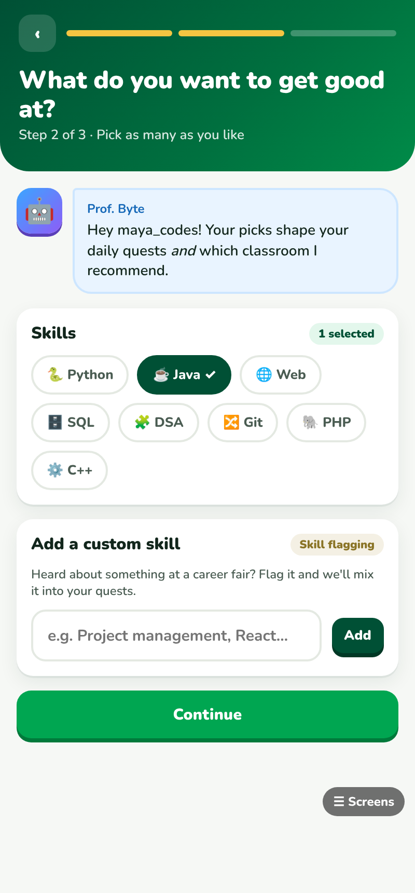
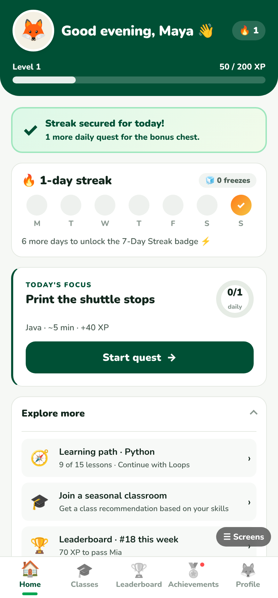
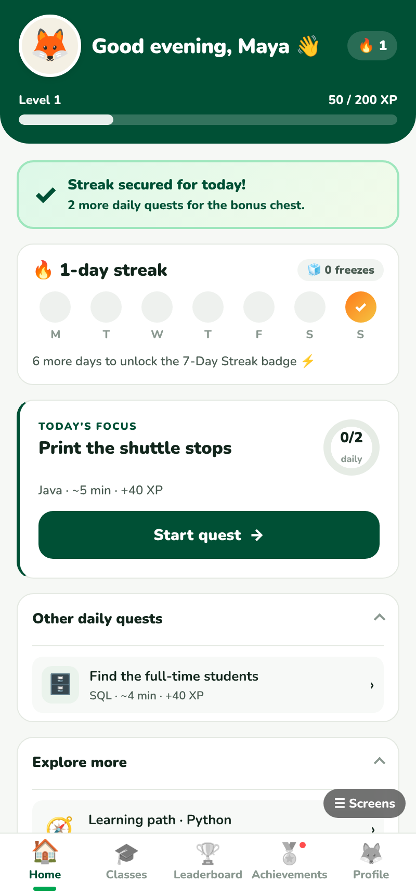
</p>
<p>
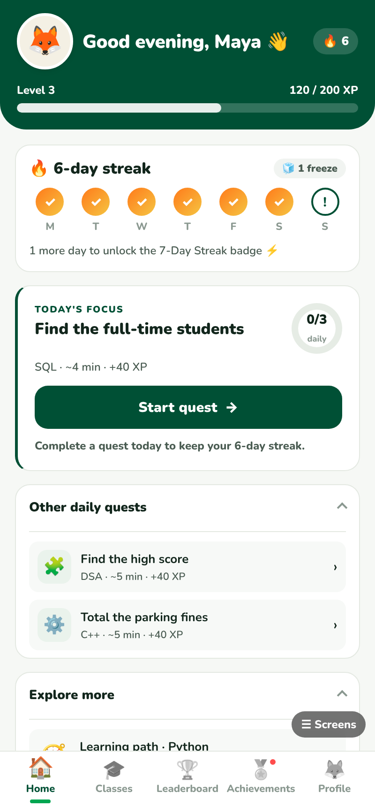
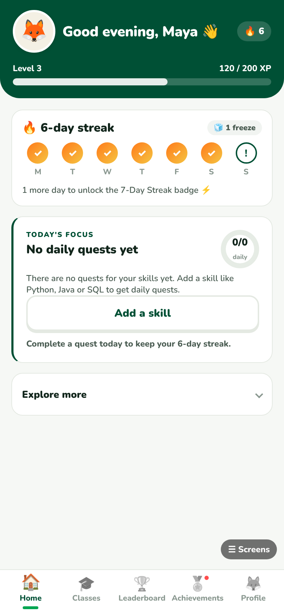
</p>

The onboarding intro quest ("Count the café orders") is the same short Python tutorial for every new student, and it can be skipped. The skill filter applies to the daily quests that come after it.

## #4 Baseline app: sign up with a UNCC email

| Acceptance criterion | How we checked | Result |
|---|---|---|
| Non-UNCC email is rejected with a clear message | Entered `maya@gmail.com`. The app says "Git Good is for Niners only — use your @charlotte.edu or @uncc.edu email." | ✅ |
| UNCC email continues to Pick skills | Entered `mchen42@charlotte.edu`, which went on to Pick skills (first screenshot in #3) | ✅ |
| At least one skill must be picked | **Continue** stays disabled until a skill is selected | ✅ |
| Completing a quest awards XP, starts the streak, returns Home | After the intro quest, Home shows 50 XP and a 1-day streak (#3 Java screenshot) | ✅ |
| Progress survives a reload | All state is saved in the browser. Every #3 check above reloads Home and keeps the skills. | ✅ |

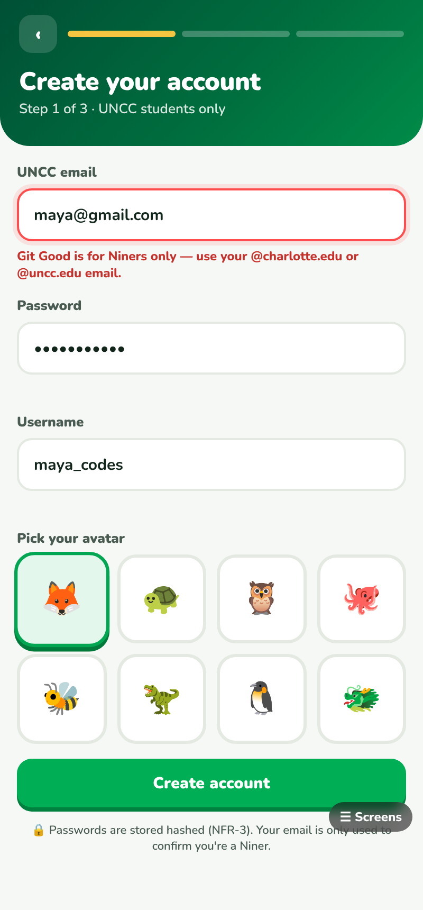

## #2 Decluttered home dashboard

Home now leads with one **Today's focus** quest. The other daily quests and the "Explore more" items are folded away until tapped.

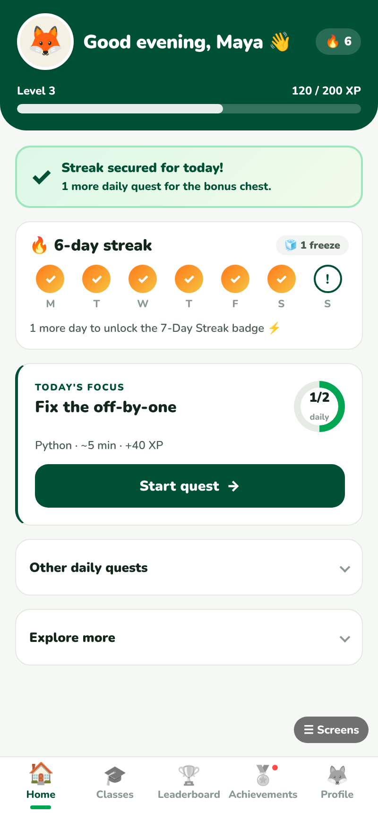

## #6 Friend invites

The **Add friends by username** button on the Friends board opens the invite sheet, and the invite is saved in the browser.

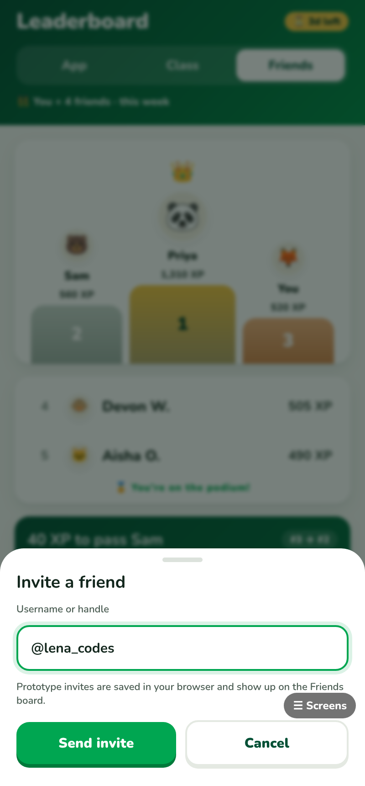

> **Note for Athena:** a new friend joins at 0 XP, so they land below the visible part of the Friends board (shown as "⋯ 1 more ⋯"). Please confirm the "invited friend appears on the Friends leaderboard" criterion before closing #6.

## #7 Lint and automated tests

| Check | Command | Result |
|---|---|---|
| ESLint on every JS file and the inline scripts in every page | `npm run lint` | ✅ 0 errors, 0 warnings |
| Unit tests for #1 and #3 | `npm test` | ✅ 18 of 18 pass |

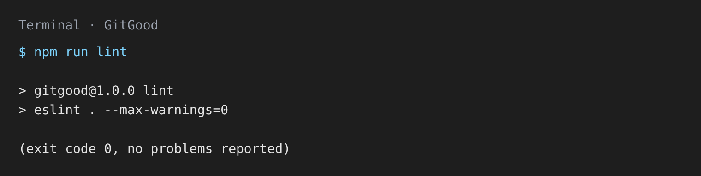

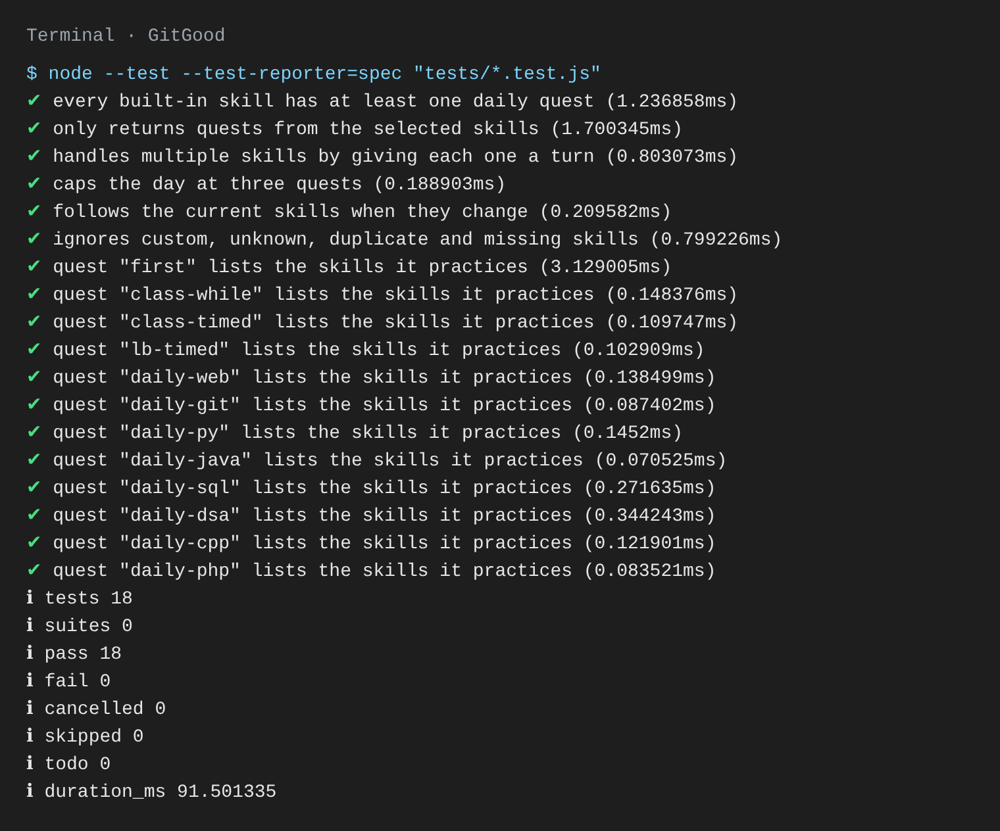

To run them yourself:
```bash
npm install
npm run lint
npm test
```
